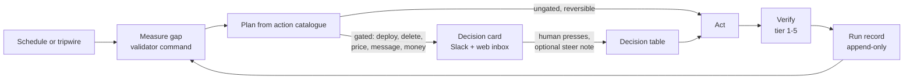
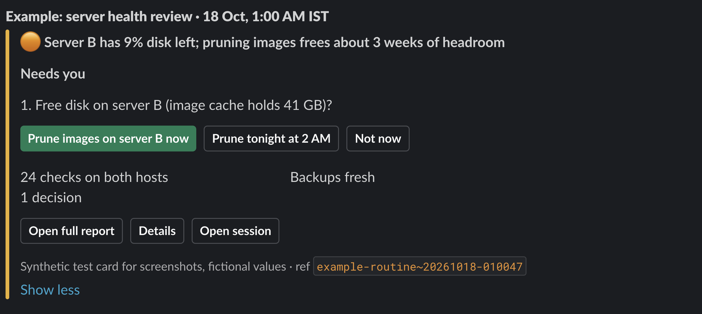
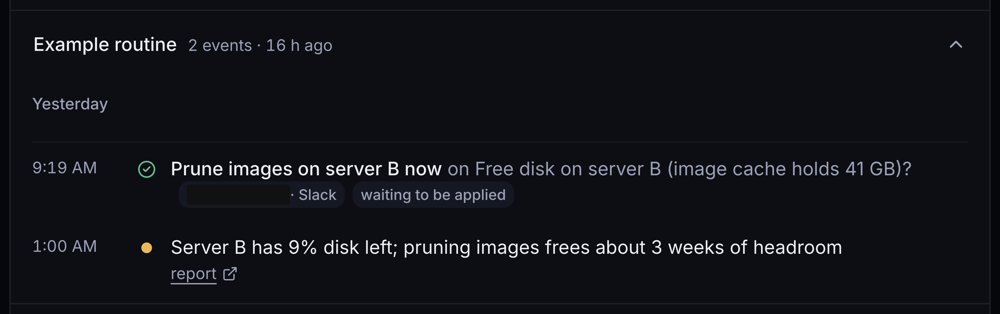

# Running a company on AI agents, with a human on every outward action

**Goutam Soni** · October 2026 · [LinkedIn](https://www.linkedin.com/in/goutamsoni/) · [Read as a 4-page PDF](case-study.pdf)

In April 2026 my catalogue of public data tools made $10 in profit. In October it is on pace for
about $930. I have not hired anyone. I built it with AI coding agents, and for the last three months
agents have run it at full capacity every day: they read the numbers, research what to build next,
triage customer issues, test fixes and draft every change.
I approve anything that touches money, customers or production, usually with one tap on my phone.

The interesting part is not the agents. It is the system that lets them work unattended without
doing damage, and what broke while I built it. That is what this document is about.

## The outcome

| Month (2026) | Profit | |
|---|---|---|
| April | $10 | first paying users |
| May | $36 | |
| June | $340 | catalogue built out with AI coding agents |
| July | $651 | agents run the daily operation at full capacity (from 18 Jul) |
| August | $438 | a price change drove away the largest buyer; pricing is now a gated action |
| September | $516 | |
| October | $509 by the 17th | on pace for about $930, more than double August; target $1,000 a month by December |

*Profit as the marketplace's own console reports it, after its 20% commission and customers'
platform costs, before my own tool subscriptions. Read live on 17 Oct 2026.*

The same system runs the rest of the company (4 Step AI, an automation agency I run alone):
monitoring two servers, filing research, writing daily reports.

It is a single-operator system, not an engineering-org platform. I say where that limits the
evidence.

| | |
|---|---|
| Scheduled agent jobs | 5 cloud routines, 6 desktop routines |
| Goal loops with a measured target | 7, with 30 recorded runs this month |
| Actions agents may not take without a human gate | 50, declared per loop |
| Approval cards sent to me since 11 Oct 2026 | 185, from 15 routines |
| Decisions I pressed | 85, of which 70 applied and 42 carried a written steer |
| Incidents that became a rule or mechanism | 11 documented, 65 corrections overall |

*All figures counted from the system's own files and tables on 17 Oct 2026. Sources are in each
section.*

---

## 1. The problem

An agent that can fix a server can also reboot it at the wrong moment. An agent that can reprice a
product can reprice 84 of them. The useful version of autonomy is narrow: let agents measure, plan
and do reversible work on their own, and route everything outward or irreversible through a person,
with enough context that the person can decide in one tap.

So the system has four parts, which map closely to what a platform team would call a paved road:

1. **Contracts** that say what each agent job is for, how success is measured and what it must
   never do alone.
2. **Isolation** so a job cannot see secrets, code or state it does not need.
3. **A review gate** that turns every risky step into a decision card.
4. **Evidence rules** so "done" means a check passed, not that the agent said so.

## 2. Contracts: what an agent job may do

Every recurring job that owns an outcome is a **goal loop**. A person writes its `loop.json`; only a
small, non-model runner (`loop_run.py`) writes its state. The contract holds:

- **A goal with a number and a deadline**, and the command that measures it. The command's JSON
  output is the only source of truth. A crashing validator is recorded as a measured failure, never
  as "no data".
- **Sub-goals with a verification tier.** Tiers 1 and 2 are decided by code (exit code, number
  against a threshold). Tier 3 re-measures after a lag. Tier 4 sends artifacts and a rubric to a
  judge on a *different* model. Tier 5 asks me.
- **An action catalogue.** Each action has a cost in turns, a cooldown, an idempotency fingerprint
  (so a retry cannot post a second card or run a second deploy) and a `gate` flag.
- **`forbidden_without_gate`:** the actions this job may never take on its own. Across the 7 loops
  there are 50 entries. For the server-health loop they read: restart, prune, patch, reboot, delete,
  stop, firewall, DNS, a second card the same day.
- **A budget** (turns per run, runs per day, wall-clock minutes) and **stop rules**: stop when the
  goal is hit, escalate after N days without progress or N consecutive failures.
- **A shadow mode.** A new loop runs with `validated: false`: it measures and plans, writes what it
  *would* have done to a shadow file, and touches nothing. I flip it after reading a few runs.

A trimmed real contract is in [`examples/loop.example.json`](examples/loop.example.json).

## 3. Isolation: what an agent job can see

- **One private repository per cloud routine.** An export script builds each routine's repo from a
  manifest, so one routine can never read another's code, memory or state. Memories pass through a
  redaction step that fails closed: a file with a secret-shaped string stops the export.
- **Three environment tiers.** *Sandboxed*: no secrets, trusted network only. *Medium*: an allowlist
  of my own hosts. *Full*: only for jobs that need it, chosen per routine.
- **Secrets never enter the VM.** Since 14 Oct 2026, API keys for cloud routines are injected by the
  network proxy as headers; the agent's process never holds the value. Server SSH keys never go to
  any cloud environment; jobs that need them run on my machine.
- **On my machine**, secrets are read from the OS keychain *by name* at the moment of use and piped
  straight to the consumer. Tool servers (MCP) get credentials only through a launcher script that
  reads the keychain; no secret is ever written into a config file or passed as a tool argument.
- **A deny list** of 17 command patterns (recursive deletes of the config tree, disk tools, fleet-wide
  stop commands, workflow deletion) that no session can run, plus 14 rule hooks that block or warn on
  specific tool calls (disk-wide searches, editing generated files, the wrong browser, writing
  memory outside its store).

## 4. The review gate: how a human stays in the loop

A gated step never runs. It becomes a button on a decision card.

1. The agent calls `routine_report.py publish` with what it found, what it thinks and what it did.
   The full report goes to a document; the card carries a summary and up to three decision buttons,
   each naming the exact target ("Reboot server B tonight", not "Proceed").
2. A press goes to an n8n workflow that verifies the Slack signature, offers an optional free-text
   **steer** ("yes, but only the staging container"), writes a row to a decisions table and rewrites
   the card in place so it shows who decided, when and how.
3. The same decisions appear in a PIN-protected web inbox for when I am away from Slack.
4. The agent's next run reads the decisions, acts on exactly what was pressed and marks each row
   applied.

*A real card from the system, posted with fictional values for this document.*

*The same decision in the web inbox, with the press recorded. Handle masked.*

**One state rule drives every surface.** A decision is *pending* only if it is unpressed, its card
is not closed, no newer card from the same routine replaced it, and it is less than 7 days old.
Otherwise it is *pressed*, *applied*, *closed*, *superseded* or *expired*, and a late press is
answered "already handled" instead of acting on stale context. The rule is one function shared by
the Slack router, the web inbox and the apply step:
[`examples/decision-state.js`](examples/decision-state.js).
The whole router is importable into n8n, with identifiers replaced by placeholders:
[`examples/decision-router.workflow.json`](examples/decision-router.workflow.json) (31 nodes).

**Is it used?** Since the card system went live on 11 Oct 2026: 185 cards from 15 routines, 85
presses, 70 applied. 42 presses carried a written steer, which tells me the cards give enough
context to adjust a plan, not only to rubber-stamp it.

## 5. Evidence: how "done" is decided

The most frequent failure of an agent is not a wrong action; it is a confident false claim. Of 65
corrections I logged while building this, 14 were "done" claims that were not true.

What enforces evidence now:

- **Loops trust validators, not narration.** A sub-goal passes when its command's output passes.
- **A stop-time check** blocks a session from claiming success when its last action changed
  something and nothing was verified afterwards.
- **A watchdog checks every scheduled slot for evidence** of a real run (a run record, a card, a
  file) within a grace window. A scheduler's "succeeded" does not count.
- **Configuration rewrites are diffed for dropped keys**, after a rewrite once silently removed a
  deploy secret.

## 6. What broke, and what each failure produced

| When | What happened | What exists now |
|---|---|---|
| 4 to 6 Oct 2026 | A usage limit made 16 consecutive scheduled runs exit early; the scheduler reported them as succeeded. | Only validator output or a metric counts as proof of a run; a code-only watcher checks deliverables. |
| 15 Oct 2026 | Desktop jobs ran on a cheaper default model nobody chose. | Model and effort set per job by the capability it needs, and read back after creation. |
| Aug 2026 | A background install reported exit 0 although it had failed (exit code of the pipe, not the command). | `pipefail` everywhere; completion notices are not evidence; read the output. |
| Aug 2026 | A dry run reported "ready" while a server-side lock it could not see would block the real run. | A dry run is never a readiness claim; every write is followed by a re-read. |
| 8 Oct 2026 | An agent edited a shell script while it was running and crashed a long render. | Scripts are written to a new file and swapped in atomically. |
| Aug 2026 | Credentials reached a session transcript, which cannot be redacted afterwards. | Rotation, never redaction; commands that would print environment values are banned; secrets are read by name and piped. |
| Aug 2026 | A message blocked by quiet hours was dropped instead of delayed. | Blocked sends are scheduled for the end of quiet hours. |
| Aug 2026 | "Installed" was reported as "running" three times in one day. | A job is called running only with what triggers it and when it last fired. |
| Recurring | An unattended tool repriced 84 of 88 products. | Pricing is gated in every loop that can touch it; rewrites are diffed. |

The full log with the rule each one produced: [`docs/failure-log.md`](docs/failure-log.md).

## 7. Instructions agents actually read

- **Layered instructions.** One global file (95 lines) with 10 reference files loaded on demand,
  one per workspace, and 53 project-level files. I keep the global file short on purpose: context
  is a budget.
- **Skills as playbooks.** 118 task playbooks (deploying, running a loop, operating n8n, sending a
  card), each with a description precise enough that the right one loads for the task. A hook warns
  when a domain tool is called without its playbook loaded.
- **Shared memory with recall.** 676 notes, 221 of them corrections, indexed for full-text search.
  The four most relevant are injected on every prompt, so a correction made once is applied the
  next time without being repeated.
- **Same rules for every agent runtime.** Three different coding agents work in the same
  repositories. Their instruction files are *generated* from one source and never edited by hand;
  an adapter maps each runtime's tool calls onto the same guards.

## 8. Agents do research too, with the same evidence rules

Operations are half the work. The other half is knowing what to build. The same agents ran a market
study of 27 AI-automation communities I belong to, including the largest ones where people learn
n8n: about 21,000 post records pulled read-only, one evidence-based dossier per community, then a
cross-community synthesis. The rule was the same as for operations: real numbers and quotes, no
vibes. People-level data stays out of the outputs.

What it found, in short:

- **Communities capture demand; they do not create it.** Every large one runs on its founder's
  content channel, and growth turned on a content event, not on launch day.
- **The onboarding anchor is universal.** A pinned "start here" thread was the single most-engaged
  post in most of the communities studied.
- **Members carry the conversation.** Founders wrote a small minority of posts; the founder's job is
  content and structure.
- **Self-hosted, own-your-stack automation has real appetite and few teachers.** Communities built
  around self-hosted n8n and local AI show demand but no consistent content engine behind it.

The research agents use the same contract as the operating ones: a scoped goal, read-only access,
a written output that I review, and no outward action without a press.

## 9. Limits of this evidence

- **One human.** Adoption is me plus agents, not a team of engineers. I have not had to win trust
  from reviewers who did not build the system, which is the harder half of the job I am applying for.
- **Not a monorepo workflow.** My agents produce operational changes, reports and small code
  changes across many small repos. I have not run issue-to-draft-PR at the scale of a large
  TypeScript monorepo.
- **Measurement is young.** Loops record gap, cost and failures per run, but I do not yet have a
  benchmark of historical tasks to score agents against, and the run history is weeks, not months.
- **Some guardrails are conventions, not enforcement.** Several rules live in instructions that the
  agent follows; the deny list and hooks enforce a subset.

## 10. How this maps to agentic engineering at n8n

| The role asks for | What I would start from |
|---|---|
| Safe task categories for autonomous agents | `forbidden_without_gate` per job, gated actions as named buttons, shadow mode before a job may act |
| Isolated execution without secrets | Per-job repos, proxy-injected credentials, tiered environments |
| Linear issues picked up by agents and turned into draft PRs | The loop contract: the issue is the goal, CI is the tier-1 validator, the PR is the action, review is the gate |
| PR evidence templates | The decision card: found, thought, did, exact targets, what was verified, what still needs a human |
| Benchmarks from real historical tasks | The step I have not built yet: replay closed issues against agents and score with tier 1 to 4 checks |
| Metrics: usefulness, acceptance, rework | Press, steer and applied rates already exist for cards; the same shape works for draft PRs |

---

*Code examples here are excerpts from the running system, trimmed and with private identifiers
removed. Questions and corrections: open an issue.*
